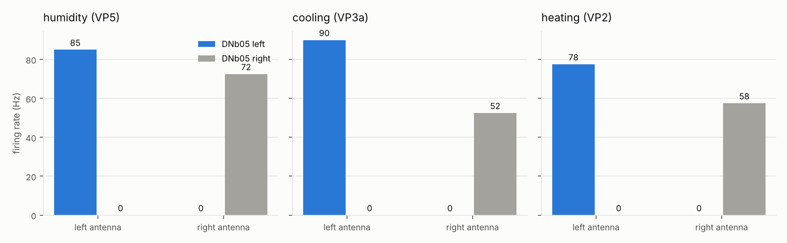
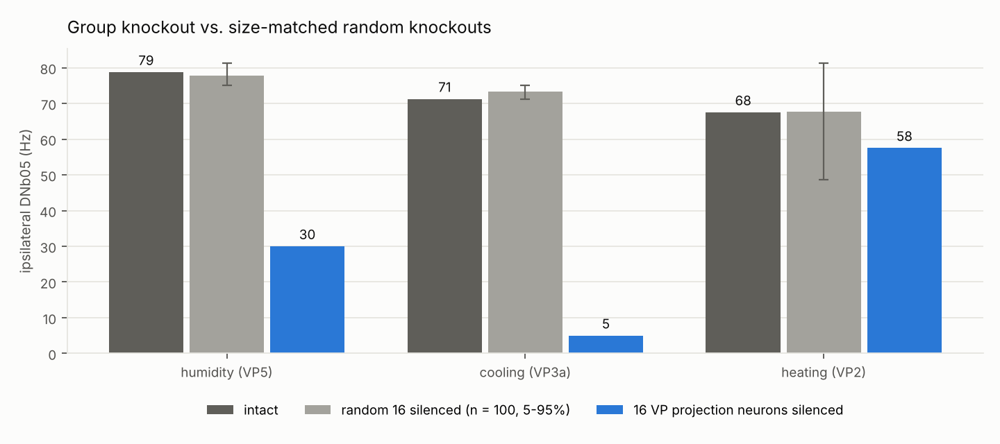
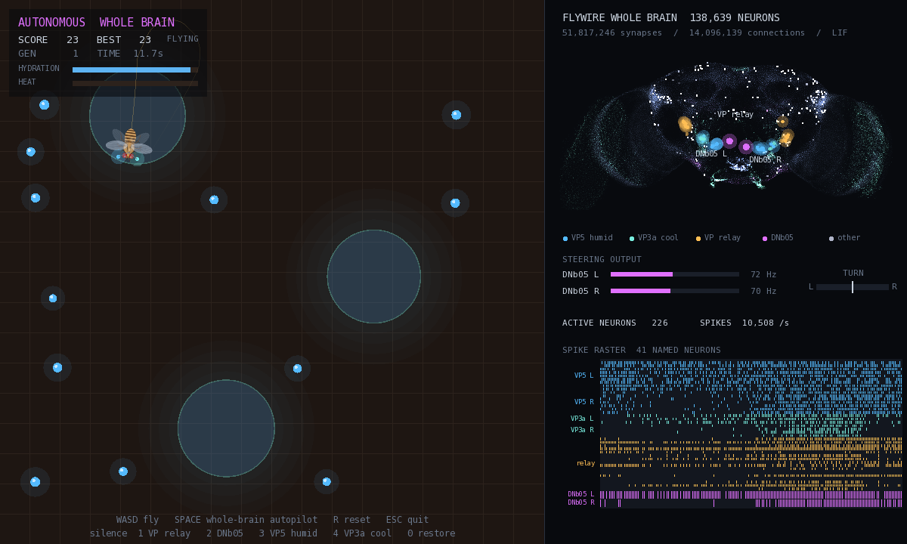
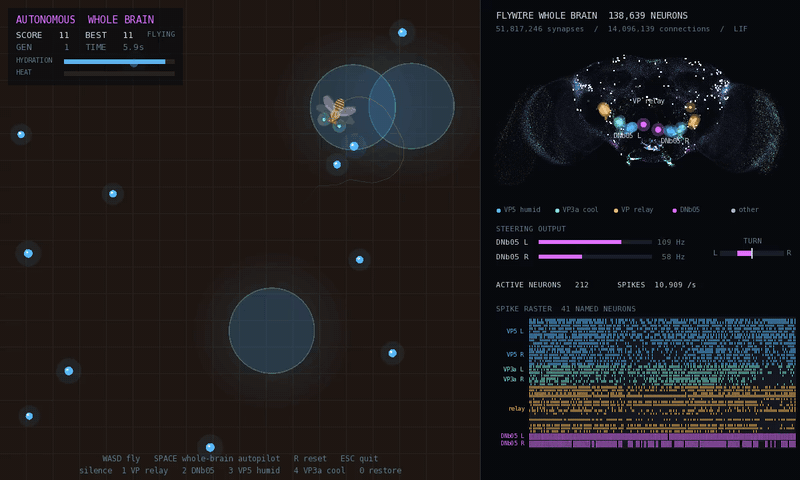
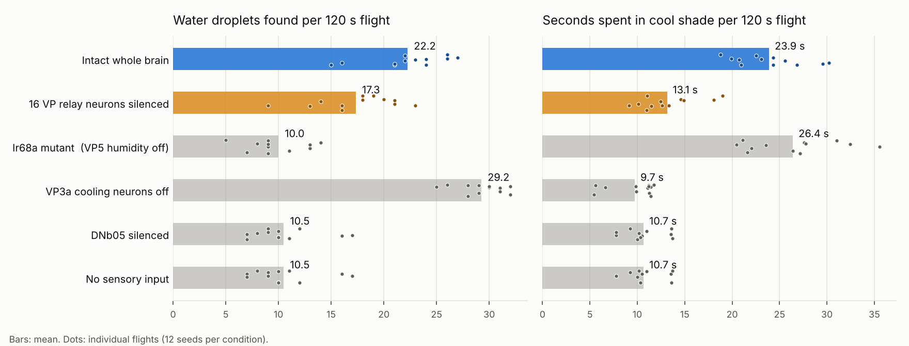

# 🪰 BioGrid: Finding Steering Pathways in a Whole Fruit Fly Brain

[](https://github.com/dorywoof/BioGrid/actions/workflows/biogrid.yml)
[](https://codex.flywire.ai/)
[]()
[]()
[]()
[](LICENSE)
[](https://hub.xerj.org/contributors/dorywoof)

**BioGrid** asks a simple question of a complete fruit fly brain: *which senses can steer the fly, and through which neurons?*

A spiking model of all **138,639 neurons and 15 million connections** of the FlyWire connectome was checked against three known fly circuits. Then all 140 paired sensory cell types were stimulated one side at a time. Only one system reaches a known steering neuron: the antenna's **humidity, cooling and heating** neurons, which all converge on the descending neuron **DNb05**. In-silico knockouts trace this route to **16 projection neurons** that synapse directly onto DNb05.

> **Prediction.** Silencing these 16 thermo-hygrosensory projection neurons should impair a fly's turning toward cool and humid air, but spare most of its heat response. This is a model prediction, testable in real flies. It has not been tested experimentally.

A companion game hands a flying fly to the **same whole-brain model**. All 138,639 neurons run live while it searches for water and shade. You can silence the predicted relay neurons mid-flight and watch the behaviour change.

📄 **Full report:** [`docs/RESEARCH.md`](docs/RESEARCH.md) · ⬇️ **Game for Windows:** [latest release](https://github.com/dorywoof/BioGrid/releases/latest)

---

## 🔬 Findings

### 1. Three senses, one steering neuron
Stimulating each antenna separately drives only the DNb05 on the same side, for humidity, cooling and heating alike.



### 2. A shared relay of 16 projection neurons
Multiglomerular VP projection neurons combine humidity input with cooling or heating input and make **756 synapses directly onto DNb05**. Silencing all 16 at once, compared with silencing 16 randomly chosen responsive neurons:

| Sense | Intact | 16 VP projection neurons silenced | 16 random neurons silenced (100 sets, 5–95%) | Empirical p |
|---|---:|---:|---:|---:|
| Humidity (VP5) | 78.8 Hz | **30.0 Hz (−62%)** | 77.7 Hz (75.0–81.2) | **0.01** (0 of 100 as low) |
| Cooling (VP3a) | 71.2 Hz | **5.0 Hz (−93%)** | 73.4 Hz (71.2–75.0) | **0.01** (0 of 100 as low) |
| Heating (VP2) | 67.5 Hz | 57.5 Hz (−15%) | 67.8 Hz (48.7–81.3) | 0.14 (13 of 100 as low) |

*Mean ipsilateral DNb05 rate across left and right stimulation. p = (1 + number of random sets at or below the group knockout) / 101. With 100 controls, 0.01 is the smallest p this test can give.*

The relay is specific: no random set came close for humidity or cooling, but for heating the group knockout is indistinguishable from chance. Heat reaches DNb05 mostly through another route.



### 3. The model was checked first
| Control | Real flies | Model |
|---|---|---|
| No input | silent | ✅ silent |
| Sugar → proboscis motor neuron MN9 | fires | ✅ 54 Hz |
| Looming → Giant Fiber escape neuron | fires | ✅ 139 Hz |
| Sugar + bitter → MN9 | suppressed | ⚠️ partly (24 Hz) |

---

## 🧭 What Is Real, and What Is a Modelling Decision

| | Real data | Modelling decision |
|---|:---:|:---:|
| Every neuron, connection and synapse count (FlyWire v783) | ✅ | |
| Cell types and literature-verified transmitters (FlyWire annotations) | ✅ | |
| Machine-predicted transmitters for neurons without verified ones | ✅ prediction | |
| LIF neuron model and constants (Shiu et al. 2024) | | ✅ |
| Monoamines left out, no feedback onto sensory axons, mushroom body left out | | ✅ |
| 100 Hz Poisson stimulation of whole sensory populations | | ✅ |
| DNb05's role in steering (Yang et al. 2024: activity tracks ipsilateral turns) | ✅ literature | |
| That DNb05 *causes* turning toward its side | | ✅ assumption |
| Game world, antenna signals and flight physics | | ✅ game design |

**Open question.** In the model, heat also drives the same-side DNb05. If DNb05 turns the fly toward its own side, the model would steer toward heat, which real flies avoid. [The report](docs/RESEARCH.md#4-interpretation-and-open-questions) discusses why, and what this means for the prediction.

---

## 🎮 The Game





A thirsty, overheating fly flies over a hot floor with water droplets and drifting patches of cool shade. Every frame, its two antennae sense humidity and cooling. These signals drive the left and right **VP5** humidity and **VP3a** cooling receptor neurons of the FlyWire brain as Poisson spike trains. All **138,639 neurons** are simulated with the same corrected model as the research above. The fly turns according to the firing difference between the left and right **DNb05**. Nothing between the antennae and DNb05 is hand-wired. The route is whatever the connectome provides.

On the right, every neuron is drawn at its real cell-body position. Spikes light up as they happen, and the named neurons (VP5, VP3a, the 16-neuron VP relay and DNb05) are highlighted and shown in a raster.

- **Flight.** The fly flies in straight bouts broken by fast **saccades**, the sharp body turns real flies use to change course. Steering signal from DNb05 builds up until it triggers a saccade. Without any signal the fly still makes occasional spontaneous saccades.
- **Landing.** It lands on water to drink and lands to rest when tired. Outside the shade its body heats up, and overheating costs hydration.
- **Lesions, live.** Keys silence neurons while you watch the behaviour change.
- **Speed.** An event-driven simulator updates only neurons that are near threshold or receiving input, so the whole brain runs about 10× faster than real time on one CPU core.

The flight physics (saccades, landing, heat and hydration) is game design. The sensor-to-DNb05 signal is the whole-brain model. In real flies, cooling receptors respond mainly to temperature *changes*, which the game does not model.

| Key | Action |
|---|---|
| `W` `A` `S` `D` | Fly manually. `A`/`D` also drive the left/right DNb05 |
| `Space` | Hand the fly to the whole brain |
| `1` / `2` / `3` / `4` | Silence the 16 VP relay neurons / DNb05 / VP5 humidity neurons / VP3a cooling neurons |
| `0` | Restore all neurons |
| `R` / `Esc` | Reset / quit |

**The prediction, tested in closed loop.** 12 seeds × 120 s of autonomous flight per condition:

| Condition | Water found | Time in shade | Deaths | vs. intact brain |
|---|---:|---:|---:|---|
| **Intact whole brain** | **22.2** | **23.9 s** | **0.7** | |
| **16 VP relay neurons silenced** | 17.3 (−22%) | **13.1 s (−45%)** | 2.1 | water **p = 0.005**, shade **p < 0.001** |
| Ir68a mutant (VP5 humidity neurons off) | 10.0 (−55%) | 26.4 s (+10%) | 1.1 | water **p < 0.001**, shade p = 0.19 |
| VP3a cooling neurons off | 29.2 (+32%) | 9.7 s (−59%) | 2.0 | water **p < 0.001**, shade **p < 0.001** |
| DNb05 silenced | 10.5 | 10.7 s | 3.2 | water **p < 0.001**, shade **p < 0.001** |
| No sensory input | 10.5 | 10.7 s | 3.2 | identical to DNb05 silenced |



*Two-sided Mann–Whitney U.* Each sense controls its own behaviour: humidity-blind flies stop finding water but still find shade, and cooling-blind flies find *more* water because they no longer detour to the shade. Silencing the 16 relay neurons hurts shade-seeking about twice as much as water-seeking, the same ordering as in the open-loop knockout (cooling −93%, humidity −62%). DNb05 silencing equals no input because the game reads steering from DNb05 only. Reproduce with `run_experiments` and `tools/plot_experiments.py`. Raw results are in [`biogrid/experiments/results/`](biogrid/experiments/results/).

### Build
The game reads the whole brain from `biogrid/data/brain.bin` (87 MB). It is generated from the public FlyWire release rather than stored in the repository:
```bash
git clone https://github.com/philshiu/Drosophila_brain_model
git clone https://github.com/flyconnectome/flywire_annotations
pip install -r research/requirements.txt
python research/export_brain.py --shiu Drosophila_brain_model \
  --annotations flywire_annotations/supplemental_files/Supplemental_file1_neuron_annotations.tsv

sudo apt install libsfml-dev cmake g++     # Windows: Visual Studio 2022, CMake fetches SFML itself
cmake -S biogrid -B build
cmake --build build
./build/biogrid
ctest --test-dir build                      # headless test: the whole brain must find water and shade
./build/run_experiments results.csv 12 120  # the lesion table above
```
The Windows release already contains `brain.bin`.

---

## 🗂️ Repository

```
research/            whole-brain model, controls, sensory screen, knockouts, figures (Python)
docs/RESEARCH.md     the full report
research/export_brain.py   writes the whole brain for the game
biogrid/             the game (C++17 / SFML), whole-brain simulator, tests and experiments
tools/               sprite and plot scripts
```

---

## 📚 Data and Credits

Connectome data comes from the FlyWire Consortium's public v783 release. Connectivity and transmitter signs are used as packaged by [Shiu et al.](https://github.com/philshiu/Drosophila_brain_model) (MIT), and cell-type annotations come from [flyconnectome/flywire_annotations](https://github.com/flyconnectome/flywire_annotations) v3.2.0. When reusing the data, please cite Dorkenwald et al. 2024, Schlegel et al. 2024, Matsliah et al. 2024, Berg et al. 2026 and Tastekin et al. 2026. The HUD font is DejaVu Sans Mono (Bitstream Vera license). The full reference list is in the [report](docs/RESEARCH.md#references).

## 📜 License

Code: MIT. See [LICENSE](LICENSE). Connectome-derived files remain subject to the terms and citation requirements of the FlyWire data release.
