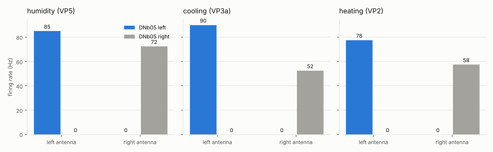
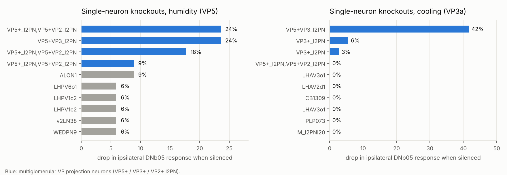
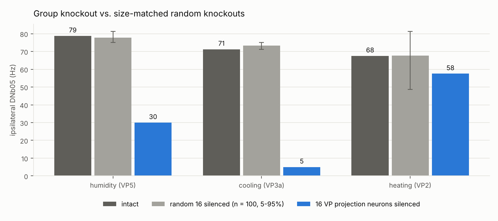
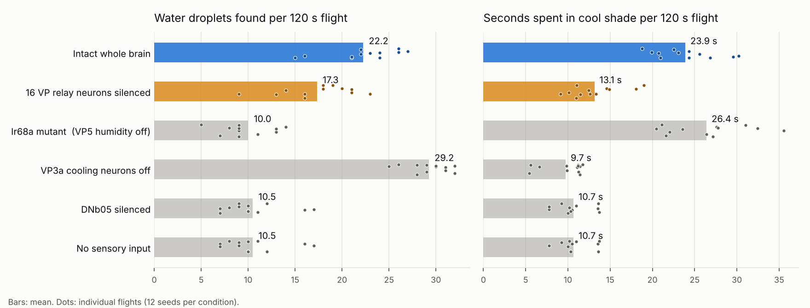

# Thermo-hygrosensory steering in a whole-brain model of the fruit fly

**Question.** Which of the fly's senses can steer it left or right, and through which neurons? A whole-brain connectome lets this be asked of every sense at once, before any experiment is run.

**Approach.** A leaky integrate-and-fire (LIF) model of the complete FlyWire connectome (138,639 neurons, 15,091,983 connections) was corrected until it reproduced three known circuits. Every paired sensory cell type was then stimulated on the left and on the right, and the responses of all paired descending neurons were recorded. The one pathway that reached a known steering neuron was dissected with in-silico knockouts.

**Result.** Of 140 sensory types, only the antennal thermo- and hygrosensory neurons (humidity VP5, cooling VP3a, heating VP2) drive a known steering descending neuron, and all three converge on **DNb05**, ipsilaterally. Silencing **16 multiglomerular VP projection neurons**, which make 756 synapses directly onto DNb05, removes most of the cooling and humidity signal but leaves most of the heating signal.

**Prediction.** Silencing these projection neurons in real flies should impair turning toward cool and humid air, while sparing most heat responses. This is a model prediction, not an experimental finding.

---

## 1. Model

| Component | Source |
|---|---|
| Connectivity, synapse counts | FlyWire v783 public release, as packaged by Shiu et al. (2024) |
| Cell types, sides, transmitters | flyconnectome/flywire_annotations v3.2.0 |
| Neuron model and constants | Shiu et al. (2024): V_rest = V_reset = −52 mV, V_th = −45 mV, τ_m = 20 ms, τ_syn = 5 ms, refractory 2.2 ms, 0.275 mV per synapse, 1.8 ms delay |
| Stimulus | 100 Hz Poisson input to the chosen sensory neurons, 500 ms (400 ms in knockouts), Δt = 0.1 ms |

### Why the published model needed corrections
Unilateral stimulation of olfactory neurons, even at 20 Hz, pushed the original model into a runaway state with about 9,900 co-active neurons, and left and right stimulation became indistinguishable. Four corrections, each targeting an observed failure, removed the runaway:

1. **Verified transmitters first.** Where an annotation records a literature-verified transmitter (`known_nt`), it replaces the machine prediction (`top_nt`). The runaway core was antennal-lobe local neurons, several of them with low-confidence predictions.
2. **Monoamines are not fast synapses.** Dopamine, serotonin and octopamine act on slow timescales, so their synapses are left out of this fast LIF model.
3. **Sensory neurons are driven only by the stimulus.** Synapses onto sensory axon terminals modulate release in reality. They do not trigger spikes, which start in the antenna.
4. **Kenyon cells are excluded.** The mushroom body is required for learned, not innate, behaviour. Its dense recurrent wiring also drove the runaway.

Spike-frequency adaptation (4 mV per spike, τ = 200 ms) was also tested. It lowered firing rates but did not stop the runaway, so it is not used.

### Controls

| Test | Expected in flies | Shiu et al. model | Corrected model |
|---|---|---|---|
| No input | silence | ✅ 0 active | ✅ 0 active |
| Sugar GRNs → MN9 (proboscis extension) | MN9 fires | ✅ 42 Hz | ✅ 54 Hz |
| Looming (LC4 + LPLC2) → Giant Fiber (DNp01) | GF fires | ✅ 158 Hz | ✅ 139 Hz |
| Sugar + bitter → MN9 | suppressed | ✅ 0 Hz | ⚠️ 24 Hz, only partly suppressed |

The corrected model passes three controls fully and one partly. Its weaker bitter suppression is a known cost of the corrections.

## 2. Screen

Each of 140 sensory cell types with at least two neurons per side was stimulated on the left and on the right. All 460 descending cell types with a left and a right copy were recorded. A descending type counts as **mirror-lateralized** when left stimulation drives its left copy more than its right, right stimulation does the reverse (or the same pattern with sides swapped), and both differences exceed 10 Hz.

- 25 sensory types mirror-lateralize at least one descending type, mostly mechanosensory bristles and Johnston's organ neurons.
- 28 sensory types still produce runaway activity (> 2,000 co-active neurons) and are not interpreted.
- **Only three sensory types reach the known steering neurons DNa01, DNa02 or DNb05, and all three reach DNb05 ipsilaterally:**

| Sense | Steering neuron | Direction | Strength |
|---|---|---|---:|
| Humidity (HRN_VP5) | DNb05 | ipsilateral | 74 Hz |
| Heating (TRN_VP2) | DNb05 | ipsilateral | 60 Hz |
| Cooling (TRN_VP3a) | DNb05 | ipsilateral | 58 Hz |



## 3. Pathway dissection

**Single-neuron knockouts.** Each of 242 non-sensory, non-descending neurons that responded to humidity or cooling stimulation was silenced in turn. No single neuron abolishes the response, so the pathway is distributed. The largest effects all come from one family: multiglomerular projection neurons that combine VP5 humidity input with VP3 cooling or VP2 heating input.



**Group knockout.** The 16 neurons of this family (`VP5+_l2PN`, `VP5+VP3_l2PN`, `VP3+_l2PN`, `VP2+VC5_l2PN`) make **756 synapses directly onto DNb05**. They were silenced together and compared with size-matched sets of randomly chosen responsive neurons.

| Sense | Intact | 16 VP projection neurons silenced | 16 random neurons silenced (100 sets, 5–95%) | Empirical p |
|---|---:|---:|---:|---:|
| Humidity (VP5) | 78.8 Hz | **30.0 Hz (−62%)** | 77.7 Hz (75.0–81.2) | **0.01** (0 of 100 as low) |
| Cooling (VP3a) | 71.2 Hz | **5.0 Hz (−93%)** | 73.4 Hz (71.2–75.0) | **0.01** (0 of 100 as low) |
| Heating (VP2) | 67.5 Hz | 57.5 Hz (−15%) | 67.8 Hz (48.7–81.3) | 0.14 (13 of 100 as low) |

*Mean ipsilateral DNb05 rate across left and right stimulation. p = (1 + number of random sets at or below the group knockout) / 101. With 100 controls, 0.01 is the smallest p this test can give.*

The relay is specific: no random set came close for humidity or cooling, but for heating the group knockout is indistinguishable from chance. Heat reaches DNb05 mostly through another route.



## 4. Interpretation and open questions

- **Consistency with experiments.** DNb05 activity tracks ipsilateral turning in walking flies (Yang et al., 2024), and DNb05 has been named a candidate output of thermosensory circuits (Jouandet et al., 2023). The model reached DNb05 without being told about either result.
- **What may be new.** None of the literature searched for this project described the VP projection neurons → DNb05 route, or humidity reaching DNb05. That literature includes Marin et al. (2020), which mapped these projection neurons. It may still be known to specialists.
- **Open question: direction.** In the model, heating drives the ipsilateral DNb05, the same as humidity and cooling. If DNb05 turns the fly toward its own side, the model would turn flies toward heat, which real flies avoid. Either DNb05's causal effect differs from its correlation with turning, heat avoidance runs mainly through other neurons, or the model misses temporal dynamics. Jouandet et al. (2023) show that thermosensory neurons respond to the *rate* of temperature change, which this model does not represent.
- **Ammonia.** Ammonia-sensing VM6v neurons do not reach DNb05 in the whole-brain model. Their weak effects elsewhere are mostly ipsilateral, which fits reports that low ammonia concentrations attract flies.

## 5. Closed-loop behaviour

The same whole-brain model was put in charge of a simulated flying fly (the [game](../README.md#-the-game)). Its antennae drive the left and right VP5 humidity and VP3a cooling receptor neurons in proportion to the nearby water and shade, and the fly turns according to the firing difference between the left and right DNb05. An event-driven C++ simulator updates only neurons near threshold or receiving input, so all 138,639 neurons run about 10× faster than real time. Each condition was flown for 12 seeds × 120 s.

| Condition | Water found | Time in shade | vs. intact (Mann–Whitney U) |
|---|---:|---:|---|
| Intact whole brain | 22.2 | 23.9 s | |
| 16 VP relay neurons silenced | 17.3 (−22%) | 13.1 s (−45%) | water p = 0.005, shade p < 0.001 |
| VP5 humidity neurons silenced | 10.0 (−55%) | 26.4 s (+10%) | water p < 0.001, shade p = 0.19 |
| VP3a cooling neurons silenced | 29.2 (+32%) | 9.7 s (−59%) | water p < 0.001, shade p < 0.001 |
| DNb05 silenced / no sensory input | 10.5 | 10.7 s | both p < 0.001 |



Removing one sense removes only its own behaviour. Silencing the 16 relay neurons impairs shade-seeking about twice as much as water-seeking, matching the open-loop result that cooling depends on the relay more than humidity does. The heating pathway was not included in the game because of the open question about its direction (section 4).

## 6. Limitations

- In the game, sensory input is a static function of distance to water and shade. Real thermosensory neurons respond to the rate of change, and real flies sample odour plumes, not smooth gradients.
- The model is a fast, point-neuron LIF network: no dendrites, no gap junctions, no neuromodulation, no adaptation, and no feedback from the body.
- Transmitter signs come from predictions for most neurons. The four corrections are modelling choices, and the results depend on them.
- Each sense was stimulated as a whole population at a fixed rate, not with natural stimulus dynamics.
- FlyWire is one female fly. Left-right asymmetries in single neurons may be individual.
- Every result here is a model prediction. None of it has been tested in a real fly.

## 7. Reproduce

```bash
git clone https://github.com/philshiu/Drosophila_brain_model
git clone https://github.com/flyconnectome/flywire_annotations
pip install -r research/requirements.txt
cd research
ARGS="--shiu ../Drosophila_brain_model --annotations ../flywire_annotations/supplemental_files/Supplemental_file1_neuron_annotations.tsv"
python controls.py $ARGS
python atlas.py    $ARGS
python dissect.py  $ARGS --random-controls 100
python figures.py
```

Run times on 4 CPU cores: controls about 1 minute, atlas about 10 minutes, dissection about 25 minutes. Raw outputs are in [`research/results/`](../research/results/).

The closed-loop experiments need the exported brain and the C++ build:

```bash
python export_brain.py $ARGS
cd .. && cmake -S biogrid -B build && cmake --build build
./build/run_experiments results.csv 12 120
python tools/plot_experiments.py results.csv
```

## References

- S. Dorkenwald et al., "Neuronal wiring diagram of an adult brain," *Nature*, 2024.
- P. Schlegel et al., "Whole-brain annotation and multi-connectome cell typing of *Drosophila*," *Nature*, 2024.
- A. Matsliah et al., "Neuronal parts list and wiring diagram for a visual system," *Nature*, 2024.
- S. Berg et al., "Sexual dimorphism in the complete *Drosophila* male central nervous system connectome," *Cell*, 2026.
- I. Tastekin et al., "The complete gustatory connectome of adult *Drosophila* reveals how taste guides feeding, foraging, and social behavior," *Cell*, 2026.
- P. K. Shiu et al., "A *Drosophila* computational brain model reveals sensorimotor processing," *Nature*, 2024.
- H. H. Yang et al., "Fine-grained descending control of steering in walking *Drosophila*," *Cell*, 2024.
- A. Rayshubskiy et al., "Neural circuit mechanisms for steering control in walking *Drosophila*," *eLife*, 2024.
- P. Jouandet et al., "Rapid threat assessment in the *Drosophila* thermosensory system," *Nature Communications*, 2023.
- E. C. Marin et al., "Connectomics analysis reveals first-, second-, and third-order thermosensory and hygrosensory neurons in the adult *Drosophila* brain," *Current Biology*, 2020.
- Z. A. Knecht et al., "Ionotropic Receptor-dependent moist and dry cells control hygrosensation in *Drosophila*," *eLife*, 2017.
- A. Vulpe et al., "An ammonium transporter is a non-canonical olfactory receptor for ammonia," *Current Biology*, 2021.
- Y. Min et al., "Dedicated olfactory neurons mediating attraction behavior to ammonia and amines in *Drosophila*," *PNAS*, 2013.
